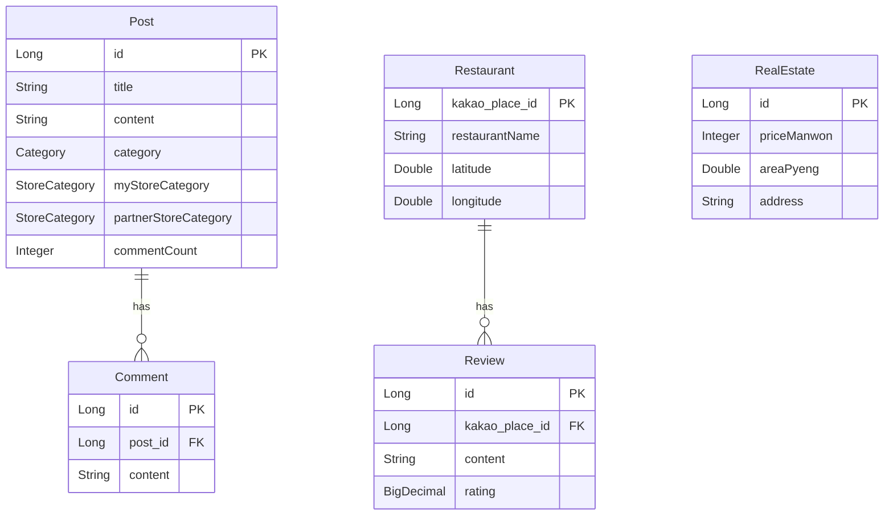

# 온길 (Ongil) Backend

창업·제휴 매칭 및 커뮤니티 기능을 제공하는 Spring Boot 백엔드 서버입니다.

## 기술 스택

| 구분 | 기술 |
|------|------|
| Language | Java 17 |
| Framework | Spring Boot 3.5, Spring Data JPA, Spring Validation |
| Database | MySQL |
| AI | OpenAI API |
| External API | Kakao Local API |
| API Docs | SpringDoc OpenAPI (Swagger UI: `/swagger`) |
| Container | Docker |
| Cloud / Infra | AWS EC2, Nginx (Blue/Green 배포) |
| CI/CD | GitHub Actions |

## 프로젝트 구조

```
ongil-be/
├── .github/workflows/     # CI/CD (빌드 → Docker Hub → EC2 배포)
├── Dockerfile
├── build.gradle
├── src/
│   ├── main/
│   │   ├── java/likelion/
│   │   │   ├── Team3BeApplication.java
│   │   │   ├── config/          # CORS, OpenAI, OpenAPI 등 설정
│   │   │   ├── controller/      # REST API 컨트롤러
│   │   │   ├── domain/entity/   # JPA 엔티티
│   │   │   ├── dto/             # 요청/응답 DTO
│   │   │   ├── exception/       # 전역 예외 처리
│   │   │   ├── jsondata/        # 시드 데이터 로더
│   │   │   ├── repository/      # JPA Repository
│   │   │   └── service/         # 비즈니스 로직
│   │   └── resources/
│   │       └── application.yml  # 프로필별 설정 (local / blue / green)
│   └── test/                    # 통합·단위 테스트
└── gradle/
```

## API 목록

| Method | Endpoint | 설명 |
|--------|----------|------|
| `GET` | `/health` | 서버 헬스체크 |
| `GET` | `/env` | 현재 배포 환경 조회 (blue / green) |
| `POST` | `/api/post` | 게시글 작성 (이미지 첨부 가능) |
| `GET` | `/api/post` | 게시글 전체 목록 |
| `GET` | `/api/post/{postId}` | 게시글 단건 조회 |
| `POST` | `/api/post/{postId}/comment` | 댓글 작성 |
| `POST` | `/api/analysis` | AI 창업 분석 |
| `POST` | `/api/partnership` | 제휴 업체 추천 |
| `GET` | `/api/restaurants` | 음식점 목록 (위·경도 포함) |
| `GET` | `/test/kakao` | 카카오 주소 → 좌표 변환 (테스트용) |

> Swagger UI: `http://localhost:8080/swagger`

## Entity 관계

```
Post (1) ──────< Comment (N)
  │
  ├─ Category (enum: GENERAL, PARTNERSHIP)
  └─ StoreCategory (enum: 카페/디저트, 한식, …)

Restaurant (1) ──────< Review (N)
  └─ kakao_place_id (PK)

RealEstate (독립 테이블)
  └─ 매매가, 평수, 층, 주소
```



## 로컬 실행

```bash
# 환경 변수 (.env 또는 시스템 환경변수)
# DB_URL, DB_USERNAME, DB_PASSWORD
# OPENAI_API_KEY, KAKAO_API_KEY, CORS_ALLOWED_ORIGINS

./gradlew bootRun --args='--spring.profiles.active=local'
```
